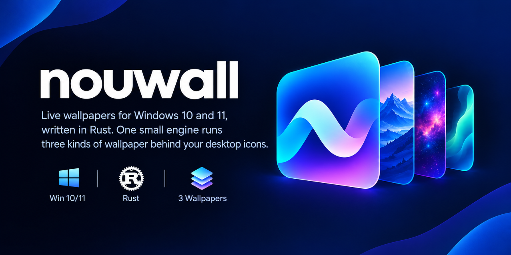

<div align="center">



# nouwall

**Live wallpaper untuk Windows yang paham kemampuan hardware, ditulis dengan Rust.**

Shader, video, dan halaman web di belakang ikon desktop, dengan peringatan
ketika wallpaper melebihi kemampuan perangkat Anda.

[](https://github.com/BBguss/Nouwall/actions/workflows/ci.yml)
[](https://github.com/BBguss/Nouwall/releases)
[](#lisensi)
[](#kebutuhan-sistem)

[English](README.md) · Bahasa Indonesia

</div>

<p align="center">
  
</p>

## Fitur

- **Tiga jenis wallpaper, satu engine kecil**
  - **Shader:** GLSL gaya Shadertoy atau WGSL, dirender dengan wgpu (DirectX 12, cadangan Vulkan/OpenGL).
  - **Video:** `.mp4`, `.mkv`, `.webm`, `.mov`, dan lainnya, di-decode hardware lewat Media Foundation.
  - **Web:** file HTML, folder dengan `index.html`, atau URL apa pun, ditampilkan lewat WebView2.
- **Mengenali hardware Anda.**
  - Memeriksa GPU, decoder video hardware, setiap monitor, dan status daya.
  - Menempatkan perangkat di tier `low`, `mid`, atau `high`.
  - Memberi peringatan sebelum wallpaper melampaui kemampuan tier itu.
- **Hemat baterai dan ramah game.**
  - Berhenti saat ada aplikasi layar penuh, sesi terkunci, atau layar mati.
  - Jeda saat jendela dimaksimalkan atau saat memakai baterai bisa diaktifkan.
  - Governor frame time menurunkan kualitas saat frame terlambat.
- **Pratinjau langsung.** Lihat wallpaper sebelum dipasang. Atur tampilan, ukuran, posisi, dan resolusi render per wallpaper.
- **Multi-monitor.** Wallpaper berbeda di tiap monitor, atau satu untuk semua.
- **Bahasa Inggris dan Indonesia.** Mengikuti bahasa tampilan Windows, atau pilih di Pengaturan.
- **Tray dan CLI.** Ganti dan jeda dari ikon tray, atau otomatisasi lewat `nouwallctl`.

## Kebutuhan sistem

- Windows 10 atau 11, 64-bit
- GPU dengan DirectX 12, Vulkan, atau OpenGL 3.3
- **WebView2 runtime** untuk wallpaper web dan jendela pengaturan. Sudah ada di Windows 11, dan di Windows 10 terpasang bersama Edge.
- **Media Foundation** untuk video. Di Windows 10 edisi N, pasang Media Feature Pack.

## Instalasi

1. Unduh `nouwall-<versi>-windows-x64.zip` dari [Releases](https://github.com/BBguss/Nouwall/releases).
2. Ekstrak di mana saja, lalu jalankan `nouwall.exe`.
3. Ikon tray muncul. Saat pertama kali dijalankan, jendela pengaturan langsung terbuka. Ada empat contoh wallpaper di library.

Agar nouwall jalan otomatis, aktifkan **Pengaturan › Umum › Mulai bersama Windows**.

> Rilis belum ditandatangani (code signing), jadi SmartScreen bisa memberi
> peringatan saat pertama kali dijalankan. Pilih **More info › Run anyway**,
> atau build sendiri dari source.

## Tier hardware

Saat dimulai, nouwall memetakan GPU ke sebuah tier lewat [`profiles.toml`](crates/nouwall-core/profiles.toml):

| Tier | Video hingga | FPS shader | Skala render | Beban shader maks. |
|------|--------------|-----------:|-------------:|-------------------:|
| low  | 1920×1080 @ 30 | 30 | 75%  | 2 |
| mid  | 2560×1440 @ 60 | 60 | 100% | 3 |
| high | 3840×2160 @ 60 | 60 | 100% | 5 |

Ini yang terjadi ketika wallpaper melampaui batas tersebut, misalnya video 4K HEVC di Intel HD 620:

- nouwall menjelaskan alasannya, misalnya *"Perangkat Anda mungkin tidak mendukung 4K dengan lancar"*, lalu meminta konfirmasi.
- Peringatan tidak pernah mengunci Anda. Konfirmasi di dialog, pakai `--force` di `nouwallctl`, atau matikan peringatan di Pengaturan.

Tier GPU Anda keliru? [Kirim laporan hardware](https://github.com/BBguss/Nouwall/issues/new?template=hardware_report.yml).

## Baris perintah

```text
nouwallctl probe [--json]            hardware, tier, dan kemampuan decode
nouwallctl list                      wallpaper di library (* = aktif)
nouwallctl apply <id> [--monitor N] [--force]
nouwallctl import <file|folder>      tambah video, shader, atau halaman web
nouwallctl settings | pause | resume | toggle | reload | quit
nouwallctl paths                     lokasi config, library, dan log
nouwallctl capture [folder]          simpan jendela wallpaper sebagai BMP (diagnostik)
```

## Konfigurasi

Config, profil GPU pengguna, dan library ada di `%APPDATA%\nouwall\`. Log dan data
WebView2 ada di `%LOCALAPPDATA%\nouwall\`. Bahasa diatur lewat
`language = "auto" | "en" | "id"` di bagian `[general]` pada `config.toml`, atau
lewat jendela pengaturan.

Format `wallpaper.toml`, panduan membuat shader GLSL/WGSL, dan cara build dari source
dijelaskan di [README bahasa Inggris](README.md#making-wallpapers).

## Kontribusi

Laporan bug, profil GPU, wallpaper, terjemahan, dan kode semuanya diterima.
Baca [CONTRIBUTING.md](CONTRIBUTING.md) dan [Code of Conduct](CODE_OF_CONDUCT.md).

## Lisensi

Dilisensikan di bawah [MIT](LICENSE-MIT) atau [Apache-2.0](LICENSE-APACHE), sesuai pilihan Anda.
