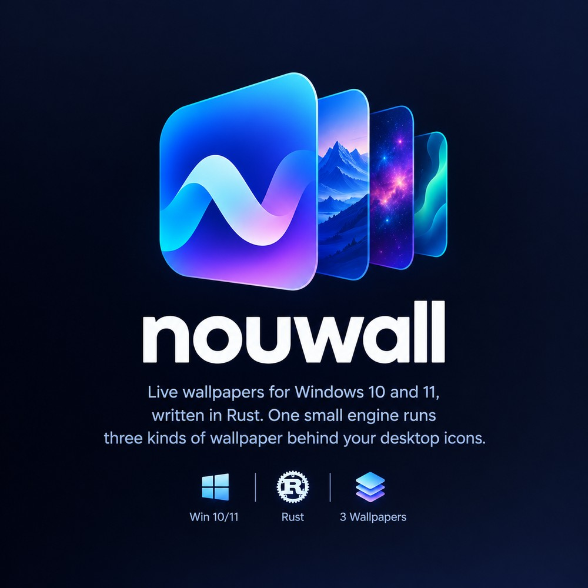
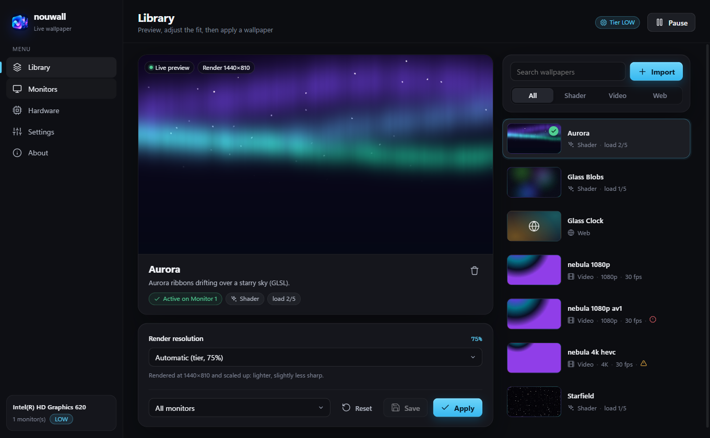
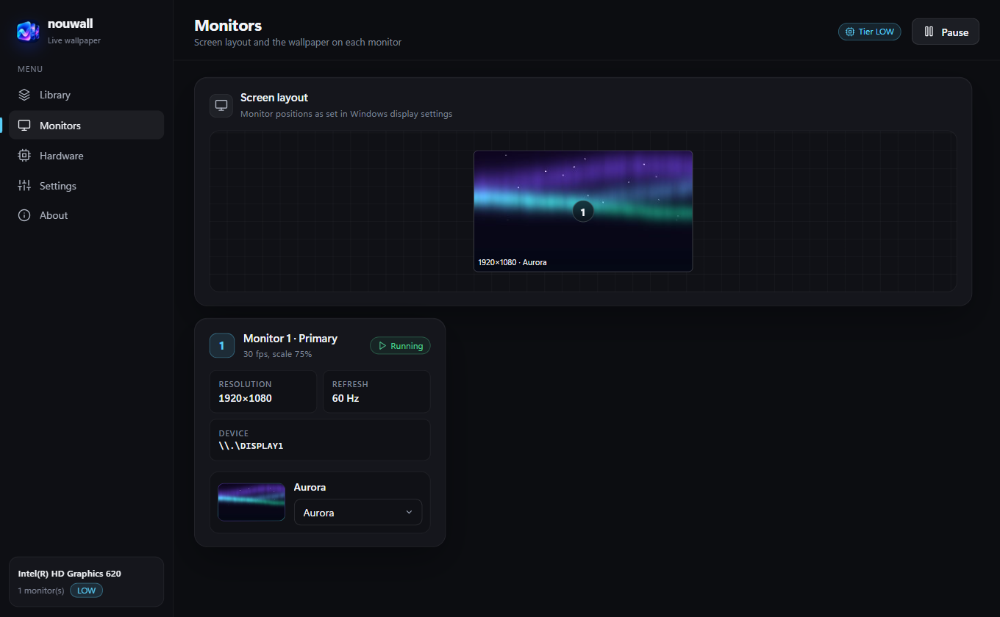
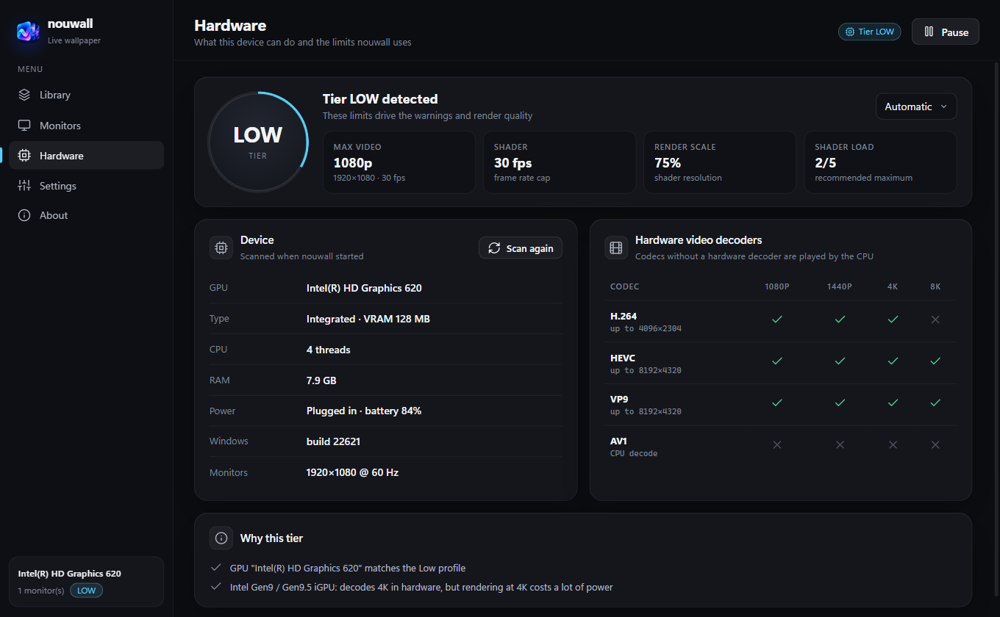
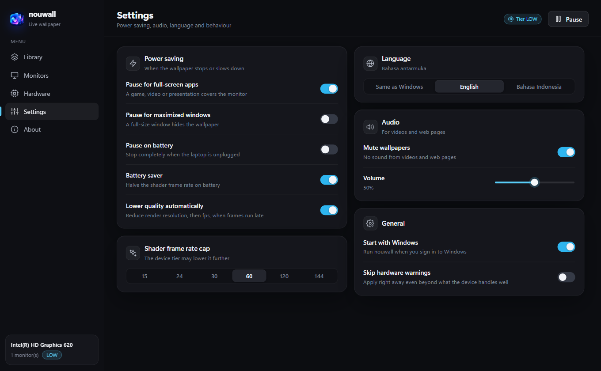

<div align="center">



# nouwall

**Hardware-aware live wallpapers for Windows, written in Rust.**

Shaders, videos and web pages behind your desktop icons, with warnings when a
wallpaper is more than your machine can handle.

[](https://github.com/BBguss/Nouwall/actions/workflows/ci.yml)
[](https://github.com/BBguss/Nouwall/releases)
[](#license)
[](#requirements)
[](https://www.rust-lang.org)

English · [Bahasa Indonesia](README.id.md)

</div>

<p align="center">
  
</p>

## Features

- **Three wallpaper kinds, one small engine**
  - **Shader:** Shadertoy-style GLSL or WGSL, rendered with wgpu (DirectX 12, with Vulkan/OpenGL fallback).
  - **Video:** `.mp4`, `.mkv`, `.webm`, `.mov` and more, decoded in hardware through Media Foundation.
  - **Web:** an HTML file, a folder with `index.html`, or any URL, shown through WebView2.
- **Knows your hardware.**
  - Probes the GPU, its hardware video decoders, every monitor and the power state.
  - Places the machine in a tier (`low`, `mid`, `high`).
  - Warns before a wallpaper goes past what the tier handles well.
- **Gentle on battery and games.**
  - Pauses for full-screen apps, a locked session or a display that is off.
  - Pausing for maximized windows or on battery is optional.
  - A frame-time governor lowers quality when frames run late.
- **Live preview.** See a wallpaper in the settings window before applying it. You can adjust fit, size, position and render resolution per wallpaper.
- **Multi-monitor.** Set a different wallpaper on each monitor, or one across all of them.
- **English and Bahasa Indonesia.** Follows the Windows display language, or pick one in Settings.
- **Tray and CLI.** Switch and pause wallpapers from the tray, or script everything with `nouwallctl`.
- **Small and native.** One Rust binary, no Electron, no background services.

## Screenshots

| Monitors | Hardware |
|---|---|
|  |  |
| **Settings** | **Bahasa Indonesia** |
|  |  |

## Requirements

- Windows 10 or 11, 64-bit
- A GPU with DirectX 12, Vulkan or OpenGL 3.3
- **WebView2 runtime** for web wallpapers and the settings window. It is built into Windows 11 and installed with Edge on Windows 10.
- **Media Foundation** for videos. On Windows 10 N editions, install the Media Feature Pack.

## Install

1. Download `nouwall-<version>-windows-x64.zip` from [Releases](https://github.com/BBguss/Nouwall/releases).
2. Extract it anywhere and run `nouwall.exe`.
3. The tray icon appears, and on first run the settings window opens. Four sample wallpapers are already in the library.

To start nouwall when you sign in to Windows, turn on **Settings › General › Start with Windows**.

> The binaries are not code-signed yet, so SmartScreen may warn on first launch.
> Choose **More info › Run anyway**, or build from source.

## Hardware tiers

When nouwall starts, it maps the GPU to a tier using [`profiles.toml`](crates/nouwall-core/profiles.toml).
Each tier has a budget:

| Tier | Video up to | Shader fps | Render scale | Max shader cost |
|------|-------------|-----------:|-------------:|----------------:|
| low  | 1920×1080 @ 30 | 30 | 75%  | 2 |
| mid  | 2560×1440 @ 60 | 60 | 100% | 3 |
| high | 3840×2160 @ 60 | 60 | 100% | 5 |

Here is what happens when a wallpaper goes past that budget, for example a 4K HEVC video on an Intel HD 620:

- nouwall explains why the wallpaper may not run well and asks for confirmation.
- A codec with no hardware decoder is flagged as critical.
- Warnings never lock you out. Confirm in the dialog, pass `--force` to `nouwallctl`, or turn them off in Settings.
- To override the tier, use **Hardware › Tier in use** or set `tier_override` in `config.toml`.

Is your GPU in the wrong tier? [Send a hardware report](https://github.com/BBguss/Nouwall/issues/new?template=hardware_report.yml).
It takes two minutes and helps everyone with the same laptop.

## Command line

`nouwallctl.exe` is the console companion and talks to the running engine:

```text
nouwallctl probe [--json]            hardware, tier and decode capabilities
nouwallctl list                      wallpapers in the library (* = active)
nouwallctl apply <id> [--monitor N] [--force]
nouwallctl import <file|folder>      add a video, shader or web page
nouwallctl settings | pause | resume | toggle | reload | quit
nouwallctl paths                     where config, library and log live
nouwallctl capture [folder]          save wallpaper windows as BMP (diagnostics)
```

`apply` exits with code 3 when warnings stop it and `--force` was not given.
The CLI uses the same language as the app.

## Configuration

| What | Where |
|------|-------|
| `config.toml`, user `profiles.toml`, library | `%APPDATA%\nouwall\` |
| Log, WebView2 data | `%LOCALAPPDATA%\nouwall\` |

```toml
[general]
language = "auto"          # auto | en | id
fps_cap = 60
pause_on_fullscreen = true
pause_on_maximized = false
pause_on_battery = false
battery_saver = true       # halve the shader frame rate on battery
auto_downgrade = true      # lower render scale, then fps, when frames run late
mute = true
volume = 0.5
suppress_warnings = false
# tier_override = "mid"
```

Everything here can also be changed in the settings window.

## Making wallpapers

Each library entry is a folder with a `wallpaper.toml`. When you import a file, nouwall creates the folder for you.

```toml
title = "Aurora"
kind = "shader"          # shader | video | web
entry = "aurora.glsl"    # file inside the folder, or a URL for web
author = "you"
description = "Moving aurora bands"
shader_cost = 2          # 1 (light) .. 5 (heavy); compared with the tier budget

[display]                # optional, also set from the Library preview
fit = "cover"            # cover | contain | stretch | center (video)
zoom = 1.0               # 0.5 .. 2.0
pan_x = 0.0              # -1 .. 1 (video)
pan_y = 0.0
resolution = 1080        # render height; omit for native
```

**GLSL** works like Shadertoy. Write `void mainImage(out vec4 fragColor, in vec2 fragCoord)` and use
`iResolution`, `iTime`, `iTimeDelta`, `iFrame`, `iMouse` and `iDate`.
Texture channels (`iChannel0..3`) are not supported yet.

**WGSL** shaders define `fn main_image(frag_coord: vec2<f32>) -> vec4<f32>` and read the uniform `u`
(`u.resolution`, `u.time`, `u.mouse`, `u.time_delta`, `u.frame`, `u.date`).
See [`starfield.wgsl`](crates/nouwall/assets/shaders/starfield.wgsl).

**Web** wallpapers are ordinary pages. Audio follows the mute setting.
While the wallpaper is paused, the page receives `nouwall:pause` and `nouwall:resume` events.
Use `requestAnimationFrame` instead of timers that run forever.

## Building from source

The repository is a Cargo workspace with two crates:

- **`nouwall-core`** is platform-independent: config, manifests, library, tiers, warning policy, pause rules, governor and i18n. It builds and tests on any OS with `cargo test -p nouwall-core`.
- **`nouwall`** is the Windows engine. It produces two binaries: `nouwall` (GUI and tray) and `nouwallctl` (console).

On Windows:

```powershell
cargo build --release
```

From Linux or macOS, use [cargo-xwin](https://github.com/rust-cross/cargo-xwin):

```sh
cargo xwin build --release --target x86_64-pc-windows-msvc
```

`scripts/dist.sh` packs the binaries, licenses and README into a release zip.
`scripts/make-icons.py` regenerates the app icon from the brand artwork in `docs/assets/brand/`.

## How it attaches to the desktop

nouwall sends the undocumented message `0x052C` to `Progman`. This makes Explorer create a `WorkerW` window between the static wallpaper and the icons.

- Before Windows 11 24H2, that `WorkerW` is a top-level window, and wallpapers become its children.
- On 24H2 and later, it is a child of `Progman`, so nouwall places a layered child window just above it.

When nouwall exits, it re-applies your static wallpaper.

> **Not yet verified:** the 24H2+ path is implemented but has only been tested on
> Windows 11 22H2. If wallpapers do not appear on 24H2 or later, please
> [open a bug report](https://github.com/BBguss/Nouwall/issues/new?template=bug_report.yml)
> with `nouwallctl probe` output and the log. The log line `desktop layout Raised` shows which path ran.

## Roadmap

- [x] Shader, video and web wallpapers
- [x] Hardware tiers and warnings
- [x] Live preview with per-wallpaper display options
- [x] English and Bahasa Indonesia
- [ ] Verified Windows 11 24H2 desktop layout
- [ ] Shader texture channels (`iChannel0..3`)
- [ ] Playlists and timed rotation
- [ ] Code-signed releases and a winget package

## FAQ

<details>
<summary><b>Does it use a lot of CPU or battery?</b></summary>

Video is decoded on the GPU when the codec is supported. Shaders are capped by the tier's frame rate and render scale.
Everything pauses when a full-screen app is in front. To save more power, turn on **Pause on battery**.
</details>

<details>
<summary><b>Why does my wallpaper disappear after Explorer restarts?</b></summary>

nouwall notices when Explorer restarts and re-attaches within a few seconds.
If it does not, choose **Change wallpaper** in the tray menu, or run `nouwallctl reload`.
</details>

<details>
<summary><b>Can I use Wallpaper Engine or Shadertoy content?</b></summary>

Shadertoy shaders that use only `mainImage` and the standard uniforms work as they are.
Wallpaper Engine scene files are not supported. Their video and web wallpapers can usually be imported directly.
</details>

## Contributing

Bug reports, GPU profiles, wallpapers, translations and code are all welcome.
Please read [CONTRIBUTING.md](CONTRIBUTING.md) and the [Code of Conduct](CODE_OF_CONDUCT.md).
Report security issues privately as described in [SECURITY.md](SECURITY.md).

## License

nouwall is licensed under either the [MIT](LICENSE-MIT) or [Apache-2.0](LICENSE-APACHE) license, at your option.
Unless you state otherwise, any contribution you submit is licensed under the same terms.
